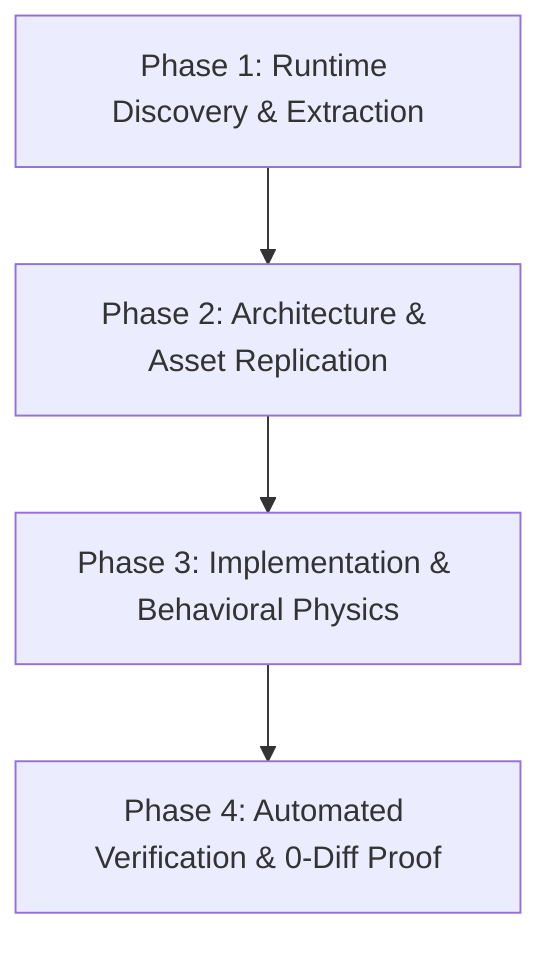

# Strict REA Clone Skill

This skill enforces a rigorous, non-permissive protocol for replicating features and UI from a target reference (e.g., Padlet) into the clone application (e.g., Padles). It prohibits guessing, approximation, or visual hallucination. Every style, layout metric, SVG asset, and interaction state must be extracted directly from live runtime evidence and proven with automated zero-diff testing.

---

## Core Mandates (Non-Negotiable)

1. **Zero Guessing & Zero Hallucination**:
   - Never estimate CSS properties, paddings, margins, colors, font weights, line heights, letter spacings, or border radii.
   - Never invent or re-draw SVG icon paths from memory. Extract exact SVGs directly from the reference DOM.
   - If a style or dimension is uncertain, query runtime evidence immediately.

2. **Runtime Extraction First**:
   - Always connect to live runtime instances (via Edge/Chrome DevTools Protocol on `127.0.0.1:9222` or REA MCP tools).
   - Use `getComputedStyle()`, `getBoundingClientRect()`, and DOM subtree dumps to establish the ground truth.

3. **Strict Zero-Diff Proof Before Completion**:
   - A cloning or comparison task is **NOT complete** until an automated script compares computed metrics between reference and clone with **0 strict diffs**.
   - Side-by-side screenshots and interactive scenario tests must be executed to verify dynamic behavior.

---

## 4-Phase Operational Protocol

### Phase 1: Runtime Discovery & Extraction
1. **Identify Browser Targets**:
   - Query `http://127.0.0.1:9222/json` to locate target tabs (reference vs. clone).
   - Alternatively, call REA MCP `list_browser_targets` or `rea-agents list-browser-targets http://127.0.0.1:9222`.
2. **Inspect Reference Elements**:
   - Execute CDP `Runtime.evaluate` to inspect reference DOM nodes.
   - Extract raw computed style tokens:
     - Typography: `font-family`, `font-size`, `font-weight`, `line-height`, `letter-spacing`.
     - Box Model: `width`, `height`, `padding`, `margin`, `box-sizing`, `border-radius`, `border`.
     - Surface & Colors: `color`, `background-color`, `box-shadow`, `backdrop-filter`.
   - Extract SVG markup: dump inner `<svg>` elements including exact `viewBox`, `path d="..."`, fill, and stroke rules.

### Phase 2: Architecture & Asset Replication
1. **DOM Structure Mirroring**:
   - Match the reference DOM hierarchy, container nesting, and semantic roles (`role="dialog"`, `role="switch"`, `aria-checked`, `aria-expanded`).
2. **Font Stack Fidelity**:
   - Ensure the exact font stack is loaded (e.g., Google Font `Inter:wght@400;500;600;700` matching Padlet's `"Inter var", Inter`).
   - Do NOT substitute fonts with system defaults (e.g. Arial or generic sans-serif) unless specified by reference.
3. **Micro-Asset Porting**:
   - Embed extracted SVG icons directly without modification.
   - Match exact asset dimensions (e.g., 16x16 icon, 32x32 button, 40x24 switch track, 20x20 switch thumb).

### Phase 3: Implementation & Behavioral Physics
1. **Layout & System Mechanics**:
   - Respect browser layout quirks (e.g. Windows dark scrollbar gutter `color-scheme: dark;`, `box-sizing: content-box` vs `border-box`).
2. **Interaction States & Animations**:
   - Inspect active/hover/focus pseudo-classes and transitions on the reference:
     - Focus ring colors (e.g. Canary `#fec006`).
     - Switch thumb physics (`translateX(16px)`, transition easing, thumb SVG swapping).
     - Subview transitions (slide-out / slide-in coordinates).
3. **Keyboard & Accessibility**:
   - Implement authentic shortcuts (e.g., <kbd>Escape</kbd> to dismiss dialogs/subpanels, <kbd>Enter</kbd> to submit).

### Phase 4: Automated Verification & Strict 0-Diff Proof
1. **Automated Token Comparison Script**:
   - Run a headless Node.js CDP script querying both target and clone concurrently.
   - Calculate deltas across all key dimensions:
     - Fonts, colors, paddings, margins, radii, widths, heights.
   - Threshold: Zero strict diffs (subpixel differences <= 1px are accepted only where text rendering engines vary).
2. **Interactive Scenario Testing**:
   - Automate user interactions (clicks, subview transitions, toggles, form inputs, dismissals).
   - Assert all state changes match expected results.
3. **Visual Verification**:
   - Capture high-resolution PNG screenshots of both reference and clone under identical viewport sizes.
   - Inspect side-by-side to guarantee visual indistinguishability.

---

## Anti-Patterns to Reject Immediately

- ❌ "This looks approximately right, around 16px padding." -> **REJECT**. Dump computed style: is it 12px, 14px, or 16px?
- ❌ "I'll use a generic toggle switch CSS." -> **REJECT**. Inspect track dimensions, thumb offsets, and internal icons.
- ❌ "I'll use an icon from FontAwesome/Lucide." -> **REJECT**. Extract the exact SVG path from the reference DOM.
- ❌ "I don't need to write a test script, it looks fine." -> **REJECT**. Automated verification script is mandatory.
