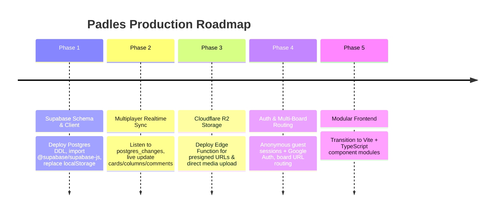

# Padles Production Architecture & Implementation Plan: Supabase + Cloudflare R2

This document details the production engineering architecture and implementation roadmap for transitioning **Padles** from a local vanilla prototype to a real-time, multi-user collaborative platform using **Supabase** (Postgres, Auth, Realtime) and **Cloudflare R2** (Zero-Egress Object Storage).

---

## 1. System Architecture Overview

```mermaid
graph TD
    subgraph Clients [Clients & Collaborators]
        UserA[User A Browser]
        UserB[User B Browser]
        Guest[Guest User (Anonymous Auth)]
    end

    subgraph SupabasePlatform [Supabase Backend Platform]
        Auth[Supabase Auth: Anonymous, Email, Google OAuth]
        Postgres[(Managed PostgreSQL 15+)]
        RLS[Row-Level Security Engine]
        RealtimeEngine[Supabase Realtime Engine: WAL + WS]
        EdgeFunc[Supabase Edge Functions: Deno / TS]
    end

    subgraph Storage [Cloudflare Edge & Storage]
        R2[(Cloudflare R2 Bucket: Zero Egress)]
        CDN[Cloudflare Global Edge CDN]
    end

    UserA -->|1. Auth & Queries| Auth
    UserA -->|2. CRUD via REST / SDK| Postgres
    UserA <-->|3. WebSockets: Postgres Changes, Presence, Broadcast| RealtimeEngine
    Postgres -->|WAL Streams| RealtimeEngine
    RealtimeEngine -->|Broadcast Sync| UserB
    RealtimeEngine -->|Broadcast Sync| Guest

    UserA -->|4. Request Presigned Upload URL| EdgeFunc
    EdgeFunc -->|Generate Presigned S3 PUT URL| UserA
    UserA -->|5. Direct Upload Attachment| R2
    R2 --> CDN -->|Public Read Stream| Clients
```

---

## 2. Why This Stack is Superior for Padles

### 2.1 Supabase (Database, Realtime & Auth)
1. **Built-in Multiplayer Primitives**:
   * **Postgres Changes (`postgres_changes`)**: Streams `INSERT`, `UPDATE`, and `DELETE` events directly from PostgreSQL WAL logs. When any user recolors a card, moves a section, or adds a comment, all active viewers receive the update in real time with zero backend boilerplate.
   * **Presence (`presence`)**: Tracks live collaborator avatars, showing who is currently on the board.
   * **Broadcast (`broadcast`)**: Ephemeral, sub-50ms peer messaging for live card dragging previews and "User is writing..." typing indicators without writing to the database.
2. **Row-Level Security (RLS)**:
   * Enforces board privacy (Public, Secret Link, Password, Private) directly in the database engine.
   * Restricts contributors to only editing or deleting their own posts while granting board creators full moderation rights.
3. **Anonymous Authentication**:
   * Critical for educational/classroom Padlet workflows where students join and contribute immediately without registering a permanent account.

### 2.2 Cloudflare R2 (Media Storage)
1. **$0 Egress Fees**:
   * Padlet boards are media-intensive (embedded videos, audio reflections, camera snapshots, high-res photos). Standard AWS S3 egress costs can become exorbitant when dozens of users view the same board. R2 has **zero bandwidth egress charges**.
2. **S3-Compatible API**:
   * Standard `@aws-sdk/client-s3` and `@aws-sdk/s3-request-presigner` packages work out of the box.
3. **Global Edge Delivery**:
   * Files and audio recordings are cached and delivered through Cloudflare’s worldwide edge CDN.

---

## 3. Production Database Schema (PostgreSQL DDL)

```sql
-- Enable UUID extension
create extension if not exists "uuid-ossp";

-- ============================================================================
-- 1. Boards
-- ============================================================================
create table public.boards (
  id uuid primary key default gen_random_uuid(),
  title text not null,
  description text default '',
  author_id uuid references auth.users(id) on delete set null,
  author_display_name text default 'Anonymous',
  settings jsonb default '{"wallpaper": "dark", "reactions": "smileys"}'::jsonb,
  is_public boolean default true,
  created_at timestamptz default now(),
  updated_at timestamptz default now()
);

-- ============================================================================
-- 2. Sections (Columns)
-- ============================================================================
create table public.sections (
  id uuid primary key default gen_random_uuid(),
  board_id uuid not null references public.boards(id) on delete cascade,
  title text not null,
  rank float8 not null default 1000.0, -- Fractional indexing for drag-and-drop
  is_default boolean default false,
  created_at timestamptz default now()
);

-- ============================================================================
-- 3. Posts (Cards)
-- ============================================================================
create table public.posts (
  id uuid primary key default gen_random_uuid(),
  section_id uuid not null references public.sections(id) on delete cascade,
  board_id uuid not null references public.boards(id) on delete cascade,
  author_id uuid references auth.users(id) on delete set null,
  author_name text default 'Anonymous',
  title text default '',
  body text default '',
  color text default 'white', -- 'white', 'red', 'yellow', 'green', 'blue', 'purple'
  type text default 'text',   -- 'text', 'video', 'link', 'image', 'audio'
  attachment jsonb default null, -- { provider, url, thumbnailUrl, caption, title, domain }
  custom_field_values jsonb default '{}'::jsonb,
  pinned boolean default false,
  rank float8 not null default 1000.0, -- Fractional indexing
  reactions_count int default 0,
  created_at timestamptz default now(),
  updated_at timestamptz default now()
);

-- ============================================================================
-- 4. Comments
-- ============================================================================
create table public.comments (
  id uuid primary key default gen_random_uuid(),
  post_id uuid not null references public.posts(id) on delete cascade,
  author_id uuid references auth.users(id) on delete set null,
  author_name text not null default 'Anonymous',
  text text not null,
  created_at timestamptz default now()
);

-- ============================================================================
-- 5. Reactions
-- ============================================================================
create table public.reactions (
  id uuid primary key default gen_random_uuid(),
  post_id uuid not null references public.posts(id) on delete cascade,
  user_id uuid references auth.users(id) on delete cascade,
  reaction_type text default 'smiley',
  created_at timestamptz default now(),
  unique (post_id, user_id)
);

-- ============================================================================
-- 6. Custom Field Definitions
-- ============================================================================
create table public.custom_fields (
  id uuid primary key default gen_random_uuid(),
  board_id uuid not null references public.boards(id) on delete cascade,
  name text not null,
  type text not null, -- 'text', 'rating', 'select', 'boolean'
  options jsonb default '[]'::jsonb,
  is_required boolean default false,
  created_at timestamptz default now()
);

-- ============================================================================
-- Realtime Subscriptions Configuration
-- ============================================================================
alter publication supabase_realtime add table public.sections;
alter publication supabase_realtime add table public.posts;
alter publication supabase_realtime add table public.comments;
alter publication supabase_realtime add table public.reactions;

-- ============================================================================
-- Row-Level Security (RLS) Policies
-- ============================================================================
alter table public.boards enable row level security;
alter table public.sections enable row level security;
alter table public.posts enable row level security;
alter table public.comments enable row level security;
alter table public.reactions enable row level security;

-- Public boards read policy
create policy "Anyone can view public boards" on public.boards
  for select using (is_public = true);

-- Public sections read policy
create policy "Anyone can view sections of public boards" on public.sections
  for select using (exists (
    select 1 from public.boards b where b.id = sections.board_id and b.is_public = true
  ));

-- Public posts read policy
create policy "Anyone can view posts of public boards" on public.posts
  for select using (exists (
    select 1 from public.boards b where b.id = posts.board_id and b.is_public = true
  ));

-- Anyone can insert posts on public boards
create policy "Anyone can insert posts on public boards" on public.posts
  for insert with check (exists (
    select 1 from public.boards b where b.id = posts.board_id and b.is_public = true
  ));

-- Authors can update their own posts
create policy "Authors can update their own posts" on public.posts
  for update using (author_id = auth.uid() or author_id is null);
```

---

## 4. Key Engineering Workflows

### 4.1 Fractional Indexing (Lexorank) for Reordering
* **Design**: Store order as floating point numbers (`rank: 1000.0, 2000.0, 3000.0`).
* **Workflow**: When moving a card between rank `1000.0` and `2000.0`, the client calculates `newRank = (1000.0 + 2000.0) / 2 = 1500.0`.
* **Advantage**: Updating a single card updates only **one database row**, emitting exactly **one Realtime event** across WebSockets with zero cascading re-renders.

### 4.2 Secure Cloudflare R2 Upload Flow
1. Client calls Supabase Edge Function: `POST /functions/v1/get-r2-upload-url` with `{ fileName, contentType, boardId }`.
2. Edge Function checks user permissions and creates a presigned S3 `PutObjectCommand` URL with a 5-minute expiry.
3. Client uploads the raw binary directly to Cloudflare R2 using `fetch(presignedUrl, { method: 'PUT', body: file })`.
4. Client attaches public CDN URL (`https://cdn.padles.com/attachments/<id>.<ext>`) to the card and inserts the post into Supabase.

### 4.3 Link Preview OpenGraph Scraper
1. In the Composer Link tool, client submits a URL (e.g., YouTube or article).
2. Edge Function scrapes the target URL using `open-graph-scraper` or `cheerio`.
3. Returns `{ title, description, domain, thumbnailUrl, provider }` to populate the link card preview.

---

## 5. Phased Migration Roadmap



### Phase 1: Database Migration & Supabase Client
* Create Supabase project and execute the SQL schema.
* Include `@supabase/supabase-js` via CDN in `index.html`.
* Adapt `app.js` `loadState()` and `saveState()` to query and mutate Supabase tables instead of `localStorage`.

### Phase 2: Live Realtime Subscriptions
* Subscribe to `supabase.channel('board-realtime')` on board load.
* Listen for `INSERT`, `UPDATE`, `DELETE` events on `posts` and `sections`.
* Synchronize changes live across open tabs and multiple users with optimistic local UI fallback.

### Phase 3: Cloudflare R2 Media Integration
* Configure Cloudflare R2 bucket with custom domain / public read URL.
* Deploy Supabase Edge Function to vend presigned upload URLs.
* Wire attachment buttons (Upload, Camera, Audio Recorder) to direct R2 uploads.

### Phase 4: Authentication & Board Routing
* Implement Anonymous Guest Auth for zero-barrier student collaboration.
* Add Google & Email OAuth login in the top navigation bar.
* Enable multi-board support with dynamic URL routing (`padles.com/b/:boardId`).

### Phase 5: Modular TypeScript Build System
* Decompose monolithic `app.js` and `styles.css` into focused Vite + TypeScript component modules without altering any design tokens or UI states.
