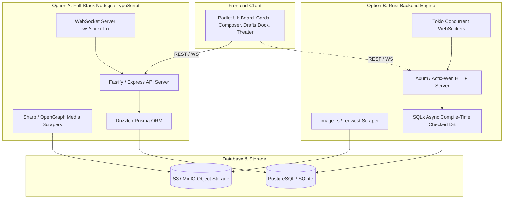
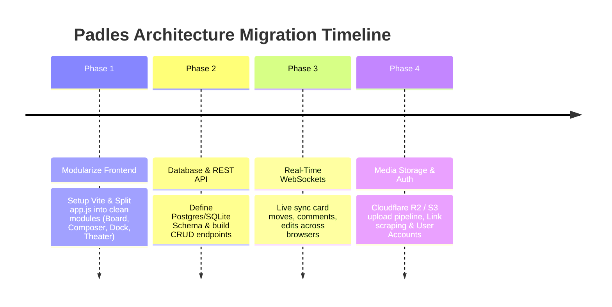

# Architectural Evolution Plan: Scaling Padles from Vanilla Prototype to Production

## 1. Executive Summary & Recommendation

Padles currently runs as a client-side vanilla JavaScript monolith (`index.html`, `styles.css`, `app.js` ~3,000 lines each) storing state in browser `localStorage`. 

While this prototype architecture provided zero-dependency iteration speed, a **100% Padlet clone** fundamentally requires:
1. **Multiplayer Real-Time Sync**: Multiple users viewing and editing cards, dragging sections, and commenting concurrently via WebSockets.
2. **Persistent Cloud Storage**: Reliable relational database storage (PostgreSQL/SQLite) replacing local browser storage.
3. **Media Processing Pipeline**: Server-side file uploads, image compression, YouTube/Link OpenGraph metadata scraping, and audio recording storage.
4. **Maintainable Codebase**: Component modularization so cards, sections, drafts dock, and theater view can be maintained independently without 3,000-line single-file cognitive overload.

### The Recommendation
> [!IMPORTANT]
> **Recommended Stack**: **Vite + React (or Modular TypeScript) Frontend + Node.js / Fastify / TypeScript Backend + PostgreSQL / SQLite + WebSockets**.
> 
> **Why Node.js over Rust for this stage**: Padlet's business logic involves rapid UI iterations, complex nested JSON schemas (custom fields, reactions, draft docks, 21 media tools), and dynamic third-party API integrations (OpenGraph scrapers, Google Drive, YouTube oEmbed). TypeScript across client and server provides **shared type definitions**, instant iteration velocity, and unmatched web ecosystem libraries (`sharp`, `open-graph-scraper`, `ws`, `drizzle-orm`).
>
> **Where Rust Shines**: If your primary objective is learning Rust systems programming, minimizing VPS hosting memory to under 30MB RAM, or building an ultra-high-throughput WebSocket broadcast engine that handles 50,000+ simultaneous connections on a $5/mo server, **Rust (Axum + Tokio)** is unbeatable.

---

## 2. Deep Dive: Option A (Node.js / TypeScript) vs Option B (Rust)



### 2.1 Option A: Node.js + TypeScript (Pragmatic & Rapid Feature Velocity)
* **Architecture**: 
  * **Frontend**: Vite + TypeScript (React or Lightweight Web Components) preserving all current Padlet CSS and DOM structures.
  * **Backend**: Fastify or Express + TypeScript.
  * **Real-Time**: Native `ws` or `Socket.io` rooms per board (`room: board-{id}`).
  * **Data Layer**: Drizzle ORM or Prisma with PostgreSQL (or SQLite for single-file deployment).
  * **Media Worker**: `sharp` (instant WebP/JPEG thumbnail generation), `open-graph-scraper` (link card scraping).

#### Strengths
* **End-to-End Type Safety**: A single `types/board.ts` file defines `Card`, `Section`, `Draft`, `CustomField`, and `WebSocketMessage`. If you modify a card field, both client and server validate it instantly at compile time.
* **Ecosystem Richness for Media**: Padlet requires scraping link thumbnails, embedding Spotify/YouTube, and processing attachments. Node.js has pre-built packages for every web metadata specification.
* **Rapid Iteration**: Zero compile wait times; changes reflect in sub-second Hot Module Replacement (HMR).

#### Weaknesses
* Memory footprint: ~150MB–250MB baseline RAM per container.
* Single-threaded event loop requires worker threads for heavy media transcoding.

---

### 2.2 Option B: Rust Backend (Maximum Concurrency, Safety & Efficiency)
* **Architecture**:
  * **Frontend**: Vite + TypeScript (React or Svelte).
  * **Backend**: **Axum** (maintained by the Tokio team) + **Tokio** runtime.
  * **Real-Time**: Tokio Broadcast Channels / WebSockets.
  * **Data Layer**: **SQLx** (compile-time checked SQL queries against real DB schema) + PostgreSQL/SQLite.
  * **Media Handling**: `image-rs` for image resizing, `reqwest` + `scraper` for HTML scraping.

#### Strengths
* **Extreme Resource Efficiency**: Idles at ~15MB–30MB RAM. Can easily serve thousands of active boards on a minimal $4–$5/mo VPS.
* **Rock-Solid Real-Time Concurrency**: Tokio handles tens of thousands of concurrent WebSocket broadcast connections without memory leaks or garbage collection stutter.
* **Reliability & Crash Resistance**: Rust's ownership model and strict type system eliminate runtime crashes, null pointer exceptions, and data races. Compile-time SQL validation ensures zero SQL syntax typos reach production.

#### Weaknesses
* **Development Velocity**: Developing complex dynamic mutations (such as custom field builders with flexible JSON types, dynamic filter graphs, and rich text parser trees) takes roughly 2.5x to 3x longer than TypeScript.
* **No Direct Shared Client-Server Code**: The frontend remains TypeScript, meaning types must be kept in sync manually or via code generators (e.g., `ts-rs` or OpenAPI generators).

---

## 3. Side-by-Side Comparison Matrix

| Evaluation Dimension | Option A: Node.js (TypeScript) | Option B: Rust (Axum / Tokio) | Winner / Verdict |
| :--- | :--- | :--- | :--- |
| **Development Speed** | ⚡ **Very Fast** (Instant turnaround, hot reload) | 🐢 **Moderate to Slow** (Strict compiler, borrow checker) | **Node.js** |
| **Code Reuse** | 🔗 **100% Shared Types** (`shared/types.ts` on client & server) | 🔄 **Requires Code Gen** (`ts-rs` or manual sync) | **Node.js** |
| **Real-Time Concurrency** | 🟢 **Good** (10,000+ connections per node with `ws`) | 🚀 **Extraordinary** (100,000+ connections on tiny footprint) | **Rust** |
| **Memory / CPU Footprint** | 🟡 **~150–300 MB RAM** | 🟢 **~15–30 MB RAM** (Minimal resource cost) | **Rust** |
| **Media & Web Scraping** | 🟢 **Abundant Ecosystem** (`sharp`, `cheerio`, `oembed`) | 🟡 **Requires Custom Assembly** (`reqwest`, `scraper`) | **Node.js** |
| **Maintainability for Padlet** | 🟢 **High** (Matches web standards, easy to refactor) | 🟢 **High** (Ultra-reliable once compiled) | **Tie** |

---

## 4. Phased Implementation Roadmap



### Phase 1: Frontend Modularization (Vite + Modular TypeScript)
* **Goal**: Decompose monolithic `app.js` (2,800 lines) and `styles.css` (3,100 lines) without touching the 100% pixel-perfect UI.
* **Structure**:
  ```
  padles-web/
  ├── src/
  │   ├── components/
  │   │   ├── board/           # Column, Section Header, DropZone
  │   │   ├── card/            # PadletCard, CardContextMenu, HoverActions
  │   │   ├── composer/        # PostComposer, AttachmentPicker, ColorPopover
  │   │   ├── drafts/          # DraftsDock, DockSlot, BulkMenu
  │   │   └── theater/         # TheaterModal, MediaCanvas, CommentsThread
  │   ├── state/               # BoardState store (Zustand or reactive signals)
  │   ├── styles/              # Design tokens, variables, component styles
  │   └── types/               # TypeScript interfaces for Post, Section, Attachment
  ```

### Phase 2: Relational Persistence Layer (PostgreSQL or SQLite)
* **Core Database Tables**:
  * `boards` (`id`, `title`, `author`, `settings_json`, `created_at`)
  * `sections` (`id`, `board_id`, `title`, `position_rank`, `is_default`)
  * `posts` (`id`, `section_id`, `title`, `content_json`, `color`, `pinned`, `position_rank`, `created_at`)
  * `comments` (`id`, `post_id`, `author_name`, `author_id`, `text`, `created_at`)
  * `reactions` (`id`, `post_id`, `user_id`, `reaction_type`)
  * `custom_field_definitions` (`id`, `board_id`, `name`, `type`, `options_json`)

### Phase 3: Real-Time Multiplayer Sync (WebSockets)
* **Message Protocol**:
  * `CARD_MOVED`: `{ cardId, sourceSectionId, targetSectionId, newIndex }`
  * `CARD_UPDATED`: `{ cardId, fields }`
  * `CARD_RECOLORED`: `{ cardId, color }`
  * `COMMENT_ADDED`: `{ cardId, comment }`
  * `USER_TYPING` / `CURSOR_POSITION`: Live collaborative indicators.

### Phase 4: Media Uploads & Metadata Worker
* Server endpoint for presigned upload URLs (Cloudflare R2 or AWS S3).
* Background scraper endpoint: given a URL (e.g. YouTube or article), returns `{ title, description, thumbnail_url, domain, provider }`.

---

## 5. Decision Checklist: Which Direction Should We Take?

1. **Option 1 (Recommended)**: **TypeScript + Node.js (Vite + Fastify/Express + Drizzle)**.
   * *Best if*: You want to ship real-time multiplayer, database persistence, and file attachments as quickly as possible with unified TypeScript.
2. **Option 2**: **Rust Backend (Axum + Tokio + SQLx) + TypeScript Frontend (Vite)**.
   * *Best if*: You want to explore Rust, prioritize rock-bottom hosting costs, and engineer a high-throughput systems backend.
3. **Option 3**: **Refactor Frontend First (Modular Vite/TS)** before introducing any backend.
   * *Best if*: You want to clean up the code organization first while keeping the app zero-server runnable in Edge/Chrome.
