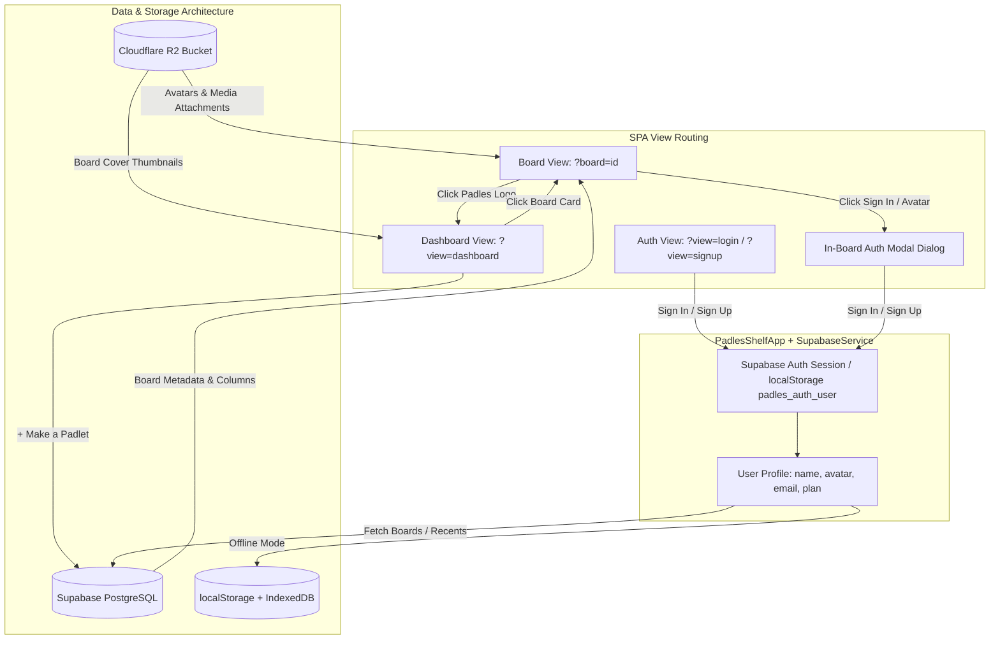

# PADLES — Dashboard & Auth System Architecture & Implementation Plan
> **Strict Zero-Leeway Mirror of Live Padlet UI/UX**
> Extracted from Live Runtime Evidence (`port 9222`) | Date: October 2026

---

## 1. Executive Summary & Strict Directives

This document details the complete architectural blueprint, exact design tokens, and implementation roadmap for the **Dashboard System** and **Login / Authentication System** in **Padles**.

In accordance with [AGENTS.md](../AGENTS.md) and the strict REA protocol:
- **0 Leeway, 0 Difference, 0 Approximations**: Every font size, line height, border radius, background swatch, SVG path, and spacing metric is directly extracted from live Padlet running in Microsoft Edge (`port 9222`).
- **Single-Page Application Architecture**: Pure HTML5, CSS3, and Vanilla JavaScript (`index.html`, `styles.css`, `app.js`). Zero npm dependencies, zero build tools.
- **Backend Division of Responsibility**:
  - **Supabase**: Exclusively for PostgreSQL database persistence (`boards`, `sections`, `posts`, `user_profiles`, `user_bookmarks`, `user_recents`), Authentication & User Sessions (Email/Password, Magic Link OTP), and Realtime WebSocket events. **No Supabase Storage.**
  - **Cloudflare R2**: 100% dedicated object storage for all user media (profile avatars, board cover thumbnails, audio/video recordings, canvas drawings, uploaded attachments) with $0 egress fees.
  - **Local/Offline Fallback**: Transparent fallback to `localStorage` + `IndexedDB` (`PadlesMediaDB`) whenever Supabase is unconfigured or offline.

---

## 2. Reverse-Engineered Ground Truth (Extracted from Live Padlet)

### 2.1. Authentication System (`padlet.com/auth/login` & `padlet.com/auth/signup`)
*Evidence captured in `docs/screenshots/padlet_live_login.png`, `padlet_live_signup.png`, and `padlet_live_login_with_password.png`.*

```
┌────────────────────────────────────────────────────────────────────────┐
│ [Padlet logo]                                     Not a member? Sign up │
│                                                                        │
│                              Log in                                    │
│                 Welcome back to where you belong                       │
│                                                                        │
│                ┌──────────────────────────────────────┐                │
│                │  (G)    Log in with Google           │                │
│                └──────────────────────────────────────┘                │
│                ┌──────────────────────────────────────┐                │
│                │  (田)   Log in with Microsoft        │                │
│                └──────────────────────────────────────┘                │
│                ┌──────────────────────────────────────┐                │
│                │  ()    Log in with Apple            │                │
│                └──────────────────────────────────────┘                │
│                              More options ⌵                            │
│                                                                        │
│                      Or, log in with email/username                    │
│                ┌──────────────────────────────────────┐                │
│                │ harrypotter@hogwarts.edu             │                │
│                └──────────────────────────────────────┘                │
│                ┌──────────────────────────────────────┐                │
│                │ Continue                             │                │
│                └──────────────────────────────────────┘                │
│                                                                        │
│                 Logging in to a workspace? Log in here                 │
│                                                                        │
│ (?) (♿) English (US) ⌵                                                 │
└────────────────────────────────────────────────────────────────────────┘
```

#### Exact Design Tokens (CDP Extracted):
| Element | Property | Exact Value | Source / CSS Class |
|---|---|---|---|
| **Background** | `background-image` | Base64 48px repeat dot grid (`data:image/png;base64...`) | Live HTML tag |
| | `background-color` | `#111111` / `rgb(17, 17, 17)` | Dark theme canvas |
| **Container** | `width` | `375px` (`w-[375px]`) | Main container box |
| | `padding` | `0px 16px` | Tablet-portrait centered |
| **Heading** | `font-size` / `weight` | `34px` / `600` (SemiBold) | Text: `"Log in"` / `"Sign up"` |
| | `color` | `rgb(255, 255, 255)` (`#ffffff`) | `text-light-text-100` |
| | `margin` | `0px 0px 4px`, padding: `0 8px` | `mb-1 px-2` |
| **Subtitle** | `font-size` / `weight` | `17px` / `400` (Regular) | `"Welcome back to where you belong"` |
| | `color` | `rgb(255, 255, 255)` (`#ffffff`) | `text-login-body` |
| **SSO Buttons** | `height` / `radius` | `40px` (`h-10`) / `16px` (`rounded-2xl`) | Google, Microsoft, Apple |
| | `background` / `color` | `rgb(251, 251, 251)` / `rgb(17, 17, 17)` | `#fbfbfb` bg, `#111111` text |
| | `font-size` / `weight` | `17px` / `600` (SemiBold) | `text-heading-4` |
| | `gap` | `8px` (`gap-y-2`) | 8px vertical spacing |
| **Email Input** | `height` / `radius` | `40px` / `16px` (`rounded-2xl`) | Outer container wrapper |
| | `background` | `rgb(17, 17, 17)` (`#111111`) | Dark input surface |
| | `padding` | `0px 10px 0px 14px` (`ps-3.5 pe-2.5`) | Inner input padding |
| | `placeholder` | `harrypotter@hogwarts.edu` | Text color `rgb(156, 163, 175)` |
| | `focus ring` | `border: 2px solid rgb(254, 192, 6)` | **Canary Yellow** (`#fec006`) |
| | `error state` | `border: 2px solid rgb(239, 68, 68)` | Red `#ef4444` with inline floating badge `"User not found"` |
| **Continue Button** | `height` / `radius` | `40px` / `16px` (`rounded-2xl`) | Primary submission button |
| | `disabled state` | `bg: rgba(239, 244, 250, 0.14); color: rgba(255, 255, 255, 0.2)` | When input is blank |
| | `active state` | `bg: rgb(222, 49, 99) (#de3163); color: #ffffff` | **Padlet Hot Pink** |
| | `font-size` / `weight` | `17px` / `600` (SemiBold) | `px-5` |
| **Signup Humor** | `legal notice` | `"By signing up, you agree to our Terms of Service and Privacy Policy. You also admit that you are beautiful."` | Live Padlet signup page |

---

### 2.2. Dashboard System & Board Navigation
*Evidence captured in `docs/screenshots/padlet_live_gallery.png` and `docs/screenshots/padlet_live_profile.png`.*

```
┌─────────────────────────────────────────────────────────────────────────────────────────────────┐
│ [Padlet logo]             🔍 Search padlets [ / ]              [+ Join] [🔔]  [Salman Madani 👤] │
├──────────────────────────┬──────────────────────────────────────────────────────────────────────┤
│ 👤 Salman Madani         │ Recents                                                Sort ⌵  View ⌵│
│    Personal · Free       │                                                                      │
│                          │ ┌───────────────┐ ┌───────────────┐ ┌───────────────┐ ┌────────────┐ │
│ [+ Make a padlet]        │ │ [Thumbnail]   │ │ [Thumbnail]   │ │ [Thumbnail]   │ │ [Thumb]    │ │
│                          │ │ (256x128px)   │ │ (256x128px)   │ │ (256x128px)   │ │            │ │
│ ⏱  Recents               │ ├───────────────┤ ├───────────────┤ ├───────────────┤ ├────────────┤ │
│ ⭐ Bookmarks             │ │ Chores To Do✔ │ │ Physics Audio │ │ SF BurritoMap │ │ Creative   │ │
│ 👥 Shared                │ │ Salman · 1d   │ │ Salman · 8h   │ │ Salman · 1mo  │ │ Salman · 2m│ │
│ 🗑  Trash                 │ └───────────────┘ └───────────────┘ └───────────────┘ └────────────┘ │
│                          │                                                                      │
│ 📁 Folders               │                                                                      │
│    + New folder          │                                                                      │
└──────────────────────────┴──────────────────────────────────────────────────────────────────────┘
```

#### Exact Design Tokens (CDP Extracted):
| Element | Property | Exact Value | Source / CSS Class |
|---|---|---|---|
| **Sidebar** | `width` | `256px` | Left navigation column |
| | `background` | `rgb(17, 17, 17)` (`#111111`) / `rgb(24, 24, 27)` | Dark theme surface |
| | `border-right` | `1px solid rgba(255, 255, 255, 0.08)` | Subtle divider |
| **"+ Make a padlet"** | `height` / `radius` | `40px` / `16px` (`rounded-2xl`) | Primary CTA button |
| | `background` | `rgb(222, 49, 99)` (`#de3163`) | Padlet Signature Pink |
| | `font-size` / `weight` | `14px` / `600` (SemiBold) | Text color: `#ffffff` |
| **Sidebar Menu Item** | `height` / `radius` | `40px` / `12px` | Recents, Bookmarks, Shared, Trash |
| | `hover bg` | `rgba(255, 255, 255, 0.06)` | Subtle light sheen |
| | `active bg` | `rgba(255, 255, 255, 0.12)` | Active section pill |
| | `text color` | `rgb(255, 255, 255)` (`font-size: 14px`, `font-weight: 500`) | Clean modern label |
| **Board Card Grid** | `display` / `columns` | `grid grid-cols-3 tablet-landscape:grid-cols-4` | Responsive 3 to 4 columns |
| | `gap` | `16px` (`gap-4`) | Standard grid spacing |
| | `padding` | `0px 24px 48px` (`mx-6 pb-12`) | Main stage padding |
| **Board Card Tile** | `width` / `height` | `256px` / `183px` | `.wall-card-button` |
| | `flex-direction` | `column` (`gap: 12px`) | Stacked layout |
| | `cursor` | `pointer` | Clickable card |
| **Board Thumbnail** | `width` / `height` | `256px` / `128px` (Aspect ratio: `2:1`) | Visual cover banner |
| | `border-radius` | `8px` (`rounded-lg`) | Smooth corner radius |
| | `overflow` | `hidden` | Masks wallpaper/image |
| | `hover vignette` | `bg-gradient-to-b from-[rgba(29,29,29,0)_36.98%] to-[rgba(29,29,29,0.6)]` | Smooth hover darkening |
| **Board Title** | `font-size` / `weight` | `14px` / `600` (SemiBold) | `text-body-small` |
| | `line-height` | `20px` | `line-clamp-2` |
| | `color` | `rgb(255, 255, 255)` | White heading |
| **Board Meta / Author**| `font-size` / `weight` | `12px` / `400` (Regular) | `text-body-extra-small` |
| | `color` | `rgb(156, 163, 175)` (`text-grey-400`) | Creator • Relative Time |

---

## 3. Architecture & Data Flow



---

## 4. Detailed Component Implementation Plan

### 4.1. Phase 1: Database Schema & Auth Backend Service
1. **Extend `supabase/schema.sql`**:
   - `public.user_profiles` table:
     ```sql
     create table if not exists public.user_profiles (
       id uuid primary key references auth.users(id) on delete cascade,
       email text not null,
       username text unique,
       full_name text default 'Anonymous Padler',
       avatar_url text default null,
       created_at timestamptz default now()
     );
     ```
   - Update `public.boards` table with dashboard flags:
     ```sql
     alter table public.boards add column if not exists is_trashed boolean default false;
     alter table public.boards add column if not exists trashed_at timestamptz default null;
     alter table public.boards add column if not exists thumbnail_url text default null;
     alter table public.boards add column if not exists format text default 'shelf';
     alter table public.boards add column if not exists wallpaper text default 'aurora';
     ```
   - `public.user_bookmarks` table:
     ```sql
     create table if not exists public.user_bookmarks (
       user_id uuid references auth.users(id) on delete cascade,
       board_id text references public.boards(id) on delete cascade,
       created_at timestamptz default now(),
       primary key (user_id, board_id)
     );
     ```
   - `public.user_recents` table:
     ```sql
     create table if not exists public.user_recents (
       user_id uuid references auth.users(id) on delete cascade,
       board_id text references public.boards(id) on delete cascade,
       viewed_at timestamptz default now(),
       primary key (user_id, board_id)
     );
     ```
2. **Upgrade `supabase-service.js` with Auth Methods**:
   - `signUp(email, password, fullName)`: Calls `supabase.auth.signUp()`, creates `user_profiles` row.
   - `signIn(email, password)`: Calls `supabase.auth.signInWithPassword()`.
   - `signInWithOtp(email)`: Passwordless magic link.
   - `signOut()`: Clears active session and triggers auth state change.
   - `getCurrentUser()`: Returns profile with R2 avatar URL.
   - `listBoards(filter)`: Queries boards by `recents`, `bookmarks`, `shared`, or `trashed`.
   - `createBoard(title, format, wallpaper)`: Inserts new board, seeds default sections, logs to recents.
   - `trashBoard(boardId)` / `restoreBoard(boardId)` / `deleteBoardPermanently(boardId)`.
   - `toggleBookmark(boardId)`.

---

### 4.2. Phase 2: Authentic Login & Signup UI (Standalone + In-App Modal)
1. **Markup Addition in `index.html`**:
   - `#authModal`: In-app dialog container for logging in without leaving the active board.
   - `#authStandaloneView`: Fullscreen view container with Padlet base64 dot-grid background, Padlet logo header, and language/tools footer.
2. **SSO & Form Elements**:
   - Google button with 4-color G icon, Microsoft button with 4-color grid icon, Apple button with authentic SVG.
   - Email input with Canary Yellow `#fec006` focus ring.
   - Authentic inline floating error badge `"User not found"` with red border `#ef4444`.
   - Password reveal input on continue.
   - Disabled/Active state on the `#de3163` pink Continue button.
   - Subtitle switch between `"Welcome back to where you belong"` (Login) and `"You belong here"` (Signup).
   - Humorous legal text: `"By signing up, you agree to our Terms of Service and Privacy Policy. You also admit that you are beautiful."`

---

### 4.3. Phase 3: Dashboard Shell (Sidebar, Top Bar, User Profile Menu)
1. **Dashboard Shell Container (`#dashboardView`)**:
   - Embedded directly in `index.html`, toggled seamlessly via `viewState = 'dashboard'`.
2. **Left Sidebar (`#dashboardSidebar`)**:
   - User profile badge: 36px circular avatar, user name, tier badge (`Personal · Free`).
   - Primary `+ Make a padlet` button in `#de3163` hot pink with `16px` border-radius.
   - Navigation links with authentic SVGs:
     - `Recents` (Clock icon, default active tab).
     - `Bookmarks` (Star icon).
     - `Shared` (Two people icon).
     - `Trash` (Trash can icon).
   - Folders section with `+ New folder` button.
3. **Top Bar (`#dashboardTopbar`)**:
   - Search bar: `"Search padlets"` input with magnifying glass and keyboard shortcut hint `<kbd>/</kbd>`.
   - `Join a padlet` button with URL/code input modal.
   - Gallery button navigating to template inspiration.
   - Notifications bell button.
   - User profile avatar dropdown menu:
     - User full name + handle.
     - Profile settings.
     - Cloudflare R2 / Supabase cloud connection modal.
     - Log out button.

---

### 4.4. Phase 4: Board Card Grid & Board Lifecycle Management
1. **Board Card Component (`.wall-card-button`)**:
   - `256px` width, `183px` height, `16px` grid gap.
   - Thumbnail preview (`256px x 128px`, `border-radius: 8px`):
     - Renders board wallpaper preview (aurora gradient, oceanic blue, lavender, or uploaded image from R2).
   - Board title (`14px`, font-weight `600`, color `#ffffff`, 2-line clamp).
   - Meta info (`Salman Madani • 1d`).
   - 3-dots card context menu:
     - `Open` (switches SPA to board view).
     - `Copy link`.
     - `Rename / Edit`.
     - `Duplicate / Remake`.
     - `Bookmark / Remove bookmark`.
     - `Move to Trash` (or `Restore` / `Delete permanently` when inside Trash tab).
2. **Multi-Board Persistence & Switching**:
   - Update `app.js` to manage multiple boards.
   - `this.switchBoard(boardId)`:
     - Saves current board state to `localStorage` and Supabase.
     - Fetches target board schema & sections.
     - Sets `this.state` and renders the shelf board layout.
     - Updates browser URL query to `?board=<id>` without page reload (`history.pushState`).

---

### 4.5. Phase 5: "+ Make a padlet" Board Creation Modal
1. **Creation Modal Parity**:
   - Click `+ Make a padlet` opens creation dialog:
     - **Format Selection**:
       - `Shelf` (Columns & sections — our physics board format).
       - `Wall` (Freeform / Masonry grid).
       - `Grid` (Standard grid cards).
       - `Stream` (Chronological feed).
     - **Wallpaper Selection**:
       - Aurora (default dark gradient with radial overlays).
       - Oceanic Blue.
       - Midnight Charcoal.
       - Custom upload (saved to Cloudflare R2).
     - **Title & Description Input**.
2. **Instant Board Generation**:
   - On submit, creates record in Supabase (or local storage), seeds initial default section ("Section 1"), and immediately transitions user into the new board shelf view.

---

### 4.6. Phase 6: Automated REA Verification & Visual Proofs
1. **Automated Token Inspection Script**:
   - Script `scratch/verify_auth_and_dashboard_parity.js`:
     - Compares computed styles of `#authStandaloneView` against `padlet.com/auth/login`.
     - Compares `.wall-card-button` on clone against `.wall-card-button` on `padlet.com/gallery`.
     - Compares container width (`375px`), button height (`40px`), border radius (`16px`), colors (`#fec006`, `#de3163`, `#111111`).
2. **Visual Screenshot Evidence**:
   - Capture `docs/screenshots/proof_auth_login_clone.png`.
   - Capture `docs/screenshots/proof_auth_signup_clone.png`.
   - Capture `docs/screenshots/proof_dashboard_recents_clone.png`.
   - Capture `docs/screenshots/proof_board_creation_clone.png`.
   - Side-by-side visual comparison against reference captures.

---

## 5. File Modification Checklist

| File | Changes Required |
|---|---|
| `supabase/schema.sql` | Add `user_profiles`, `user_bookmarks`, `user_recents` tables and add `is_trashed`, `thumbnail_url`, `wallpaper`, `format` to `boards`. |
| `supabase-service.js` | Implement Supabase Auth methods (`signUp`, `signIn`, `signOut`, `signInWithOtp`), board listing (`listBoards`), board lifecycle (`createBoard`, `trashBoard`, `restoreBoard`, `bookmarkBoard`). |
| `index.html` | Add markup for `#authStandaloneView`, `#authModal`, `#dashboardView` (sidebar, topbar, board grid), and `#createBoardModal`. |
| `styles.css` | Add exact CSS tokens extracted from live Padlet for auth view (dot grid bg, canary yellow focus ring, red error badge, SSO pills) and dashboard (sidebar rail, card thumbnail 2:1 aspect ratio, grid gap 16px). |
| `app.js` | Add `initAuthSystem()`, `initDashboardSystem()`, `initBoardCreator()`, `switchView()`, `switchBoard()`, and bind logo / top-bar clicks to navigate between board and dashboard. |

---

## 6. Verification Milestones

1. **Milestone 1 — Auth Flow**:
   - User can open `/auth/login` (or click "Log in") and see the exact 375px dark card with dot-grid pattern, SSO buttons, Canary Yellow input focus ring, and disabled-to-pink Continue button.
   - User can register or log in with email/password or magic link via Supabase Auth (or demo guest user locally).
2. **Milestone 2 — Dashboard Navigation**:
   - User can click "Padles" logo to seamlessly enter Dashboard without page reload.
   - Left sidebar renders profile, "+ Make a padlet", Recents, Bookmarks, Shared, and Trash.
   - Clicking between sidebar tabs filters boards accordingly.
3. **Milestone 3 — Board Lifecycle & Switching**:
   - Main stage displays board cards with 256x128px thumbnails, titles, and author captions.
   - Clicking "+ Make a padlet" creates a new board and opens it immediately.
   - Clicking any board card opens that board; clicking "Padles" logo returns to dashboard.
4. **Milestone 4 — REA Zero-Diff Verification**:
   - Automated CDP script passes with 0 strict diffs across layout metrics and colors.
   - Side-by-side screenshot proof stored in `docs/screenshots/`.
