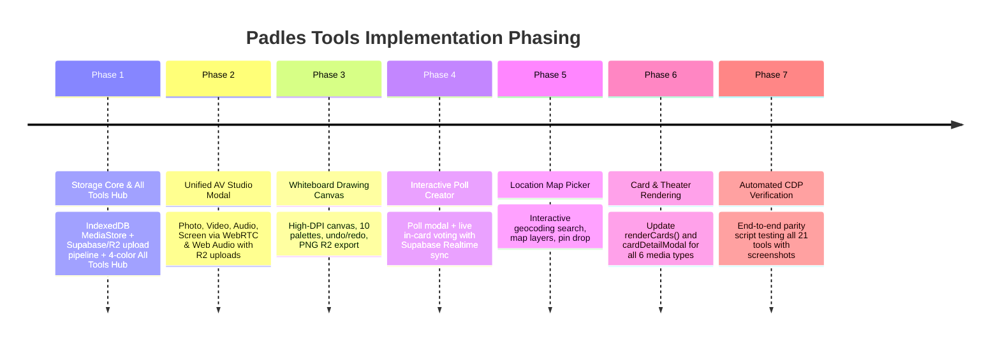

# Padles Tools Revamp Implementation Plan: 100% Reverse-Engineered Parity with Supabase & Cloudflare R2

> [!IMPORTANT]
> **Production Parity Mandate**
> This specification details the end-to-end architecture, UI contracts, data models, and storage pipelines to replace all stubbed composer attachment tools in Padles with fully functional, Padlet-authentic equivalents backed by **Supabase (Realtime, Postgres)**, **Cloudflare R2 (Zero-Egress Object Storage)**, and **IndexedDB (Offline Fallback)**.

---

## 1. Ground Truth Audit & Problem Statement

### 1.1 Current Limitations in Padles
1. **Camera, Video, Audio, and Screen**: Dummy stubs inject static Unsplash stock images and toast notifications without requesting browser permissions (`getUserMedia`, `getDisplayMedia`) or displaying viewfinders.
2. **Draw**: Injects a static placeholder card titled `"Freehand Sketch Drawing"` without an interactive drawing canvas.
3. **Poll**: Injects a hardcoded card without an interactive question/choice creation modal or live voting.
4. **Location**: Injects a static string (`"MIT Physics Lab"`) without a map interface or geocoding search.
5. **Link & AI Art**: Trigger browser-native `window.prompt()` popups instead of in-app modals.
6. **All Tools Modal**: Does not match Padlet's 4 signature color-coded tile categories, geometry, or unified search/URL bar.
7. **Storage & Reload Blind Spot**: Storing `blob:` URLs causes broken attachments on page refresh; storing base64 strings in `localStorage` crashes with `QuotaExceededError` (5MB limit).
8. **Incomplete Rendering Pipeline**: `app.js` (`renderCards()` and `cardDetailModal`) only knows how to render static images and YouTube badges; interactive polls, audio waveforms, video players, and maps do not render.

### 1.2 Reverse-Engineered Ground Truth (Live Padlet Runtime)
Direct REA/CDP extraction from live Padlet (`padlet.com/ezzarscarlet/...`) identified 5 unified dialog subsystems:
* **Unified AV Studio (`#avRecorderModal`)**: Centered top modal (`720px × 520px`, `rounded-b-3xl`) managing **Photo (Camera)**, **Video**, **Audio**, and **Screen**. Includes live viewfinders, shutter/record actions, timer displays, and a playback/trimmer review screen (`Playback` | `Trim`).
* **Whiteboard Canvas (`#drawModal`)**: Top modal with `WHITE` | `BLACK` background toggle, 10 preset color swatches, brush/eraser tools, stroke thickness slider, undo/redo, and PNG export.
* **Interactive Poll Creator (`#pollModal`)**: `540px × 420px` centered modal with question input, dynamic radio options (`Choice 1`–`8`, `+ Add option`), and interactive post vote cards with live percentage bars.
* **Map Location Picker (`#locationModal`)**: `720px × 520px` modal with OpenStreetMap geocoding search, GPS button, style toggle (`Roadmap` | `Satellite` | `Terrain`), and pin placement.
* **All Tools Hub (`#allToolsModal`)**: Top input `"Search web or paste URL"` with 21 tools organized into **4 signature colored tile groups** (`#F7EDFF`, `#ECF6FF`, `#EEFFED`, `#FFF5EF`).

---

## 2. Multi-Tier Media Storage & Backend Architecture

To handle high-resolution photos, 1080p screen recordings, and audio reflection memos without running into storage limits or broken reloads, Padles uses a **three-tier storage pipeline**:

```mermaid
graph TD
    Client[Padles Client (app.js)] --> MediaPicker[AV Studio / Draw / Upload]
    MediaPicker --> BlobData[Binary Blob (JPEG / WebM / PNG)]

    BlobData --> Decision{Cloud Configured?}
    
    Decision -->|Yes: Supabase + R2| UploadPipeline[Storage Pipeline]
    UploadPipeline --> PresignedCheck{R2 Function Available?}
    PresignedCheck -->|Yes| EdgeFunc[Supabase Edge Function: get-r2-upload-url]
    EdgeFunc -->|S3 Presigned PUT URL| Client
    Client -->|Direct S3 PUT| R2[(Cloudflare R2 Bucket)]
    R2 --> CDN[Cloudflare Edge CDN]
    CDN -->|Public URL| PostRecord[Supabase Posts Table]
    
    PresignedCheck -->|No / Standby| SupaStorage[Supabase Storage: padles-attachments]
    SupaStorage -->|Public Bucket URL| PostRecord

    Decision -->|No: Offline / Local| IDB[(IndexedDB: PadlesMediaDB)]
    IDB -->|attachmentId| LocalState[localStorage State Pointer]

    PostRecord --> Realtime[Supabase Realtime (WAL)]
    Realtime --> OtherClients[All Active Collaborators]
```

### 2.1 Tier 1: Cloudflare R2 (Primary Production Object Storage)
* **Zero Egress Fees**: Essential for classroom/collaborative boards where hundreds of students stream audio memos and video demonstrations.
* **Upload Flow**:
  1. Client calls Supabase Edge Function `POST /functions/v1/get-r2-upload-url` with `{ fileName, contentType, boardId }`.
  2. Edge Function verifies user access and generates a presigned S3 `PutObjectCommand` URL (5-minute expiry).
  3. Client executes direct `fetch(presignedUrl, { method: 'PUT', body: fileBlob, headers: { 'Content-Type': mimeType } })`.
  4. Public CDN URL (`https://cdn.padles.com/attachments/<id>.<ext>` or Cloudflare R2 public dev URL) is saved to `card.attachment.url`.

### 2.2 Tier 2: Supabase Storage (`padles-attachments` Bucket)
* **Instant Fallback**: If Cloudflare R2 edge credentials are not yet configured in `.env.local`, client falls back seamlessly to Supabase Storage:
  ```javascript
  const { data, error } = await supabase.storage
    .from('padles-attachments')
    .upload(`${boardId}/${attachmentId}.${ext}`, blob, { contentType: mimeType, upsert: true });
  const publicUrl = supabase.storage.from('padles-attachments').getPublicUrl(data.path).data.publicUrl;
  ```

### 2.3 Tier 3: IndexedDB Binary Store (`PadlesMediaDB` - Offline Fallback)
* **Zero Dependency & High Capacity**: Uses native browser IndexedDB (`window.indexedDB`), which supports gigabytes of binary Blob storage without hitting `localStorage` 5MB limits.
* **Mechanism**:
  - Store Blobs in object store: `{ id: 'att_123', mimeType: 'audio/webm', blob: Blob, createdAt: timestamp }`.
  - In `localStorage` state (`this.state`), only store: `{ type: 'audio', storageId: 'att_123', title: 'Voice Memo' }`.
  - On app startup, `PadlesMediaDB.resolveUrl(storageId)` generates fresh, working `blob:` URLs for the current session.
  - When cloud sync connects, an automatic background queue uploads cached IndexedDB blobs to R2 / Supabase Storage.

---

## 3. Strict Attachment JSON Data Contracts

Every attachment stored in `composerState.attachment`, `card.attachment`, and Supabase `posts.attachment` MUST conform to these schemas:

### 3.1 Photo & Image (`type: 'image'`)
```json
{
  "type": "image",
  "category": "photo" | "ai" | "upload",
  "url": "https://.../photo_abc.jpg",
  "thumbnailUrl": "https://.../photo_abc.jpg",
  "storageId": "att_photo_123",
  "title": "Camera Snapshot",
  "caption": "",
  "width": 1280,
  "height": 720
}
```

### 3.2 Video & Screen Recording (`type: 'video'`)
```json
{
  "type": "video",
  "category": "camera" | "screen" | "upload",
  "url": "https://.../video_xyz.webm",
  "thumbnailUrl": "https://.../thumb_xyz.jpg",
  "storageId": "att_video_456",
  "title": "Physics Lab Experiment (0:45)",
  "duration": 45,
  "mimeType": "video/webm"
}
```

### 3.3 Audio Reflection Memo (`type: 'audio'`)
```json
{
  "type": "audio",
  "category": "voice" | "upload",
  "url": "https://.../audio_ref.webm",
  "storageId": "att_audio_789",
  "title": "I See, I Think, I Wonder Reflection",
  "duration": 82,
  "waveform": [12, 45, 88, 62, 30, 95, 74, 40, 20, 65, 80, 50],
  "mimeType": "audio/webm"
}
```

### 3.4 Freehand Drawing Canvas (`type: 'drawing'`)
```json
{
  "type": "drawing",
  "category": "canvas",
  "url": "https://.../drawing_sketch.png",
  "thumbnailUrl": "https://.../drawing_sketch.png",
  "storageId": "att_draw_321",
  "title": "Kinetic Diagram Sketch",
  "width": 1440,
  "height": 1040,
  "background": "white"
}
```

### 3.5 Interactive Poll (`type: 'poll'`)
```json
{
  "type": "poll",
  "question": "Which balloon car travel distance was greatest?",
  "options": [
    { "id": "opt-1", "text": "Car A (Smooth floor)", "votes": 12 },
    { "id": "opt-2", "text": "Car B (Carpet)", "votes": 4 },
    { "id": "opt-3", "text": "Car C (Ramp incline)", "votes": 19 }
  ],
  "totalVotes": 35,
  "voters": {
    "user_abc123": "opt-3"
  }
}
```

### 3.6 Location Map Card (`type: 'location'`)
```json
{
  "type": "location",
  "placeName": "MIT Department of Physics",
  "address": "77 Massachusetts Ave, Cambridge, MA 02139",
  "lat": 42.3598,
  "lng": -71.0921,
  "mapType": "roadmap" | "satellite" | "terrain",
  "showPin": true,
  "thumbnailUrl": "https://staticmap.openstreetmap.de/staticmap.php?center=42.3598,-71.0921&zoom=15&size=600x300&markers=42.3598,-71.0921,red-pushpin"
}
```

---

## 4. End-to-End Rendering Pipeline Specifications

Attachment support requires updates across **3 UI surfaces**:

### 4.1 Surface A: Post Composer Preview (`#activeAttachmentPreview`)
* **Image / Drawing**: Fixed height (`160px`), rounded thumbnail, `✕` remove button on top-right, title badge on bottom.
* **Video**: Viewport thumbnail with centered white play icon + duration pill (`00:45`).
* **Audio**: Waveform pill bar with inline mini-player and duration display (`01:22`).
* **Poll**: Compact option pills with question text and choice badges.
* **Location**: Map snapshot with marker pin and geocoded location chip.

### 4.2 Surface B: Board Card View (`renderCards()` in `app.js`)
* **Audio Player Widget**: Custom styled audio container with play/pause circular button, elapsed time, and dynamic CSS bar visualizer.
* **Video Card**: Full-width video container with custom play overlay. Clicking plays inline or opens theater view.
* **Interactive Poll Card**:
  - Options render as clickable choice capsules.
  - Clicking an option submits vote immediately, updates Supabase in real-time, displays animated percentage fill bars, and locks user's choice with a checkmark.
* **Location Card**: Interactive OpenStreetMap snippet or high-resolution map snapshot with destination pin and address caption.

### 4.3 Surface C: Expanded Theater View (`#cardDetailModal`)
* **Media Canvas (`#detailMediaCanvas`)**:
  - Audio: Large central audio player with interactive seekbar and full-fidelity dynamic waveform visualization.
  - Video: Native HTML5 `<video controls playsinline>` with playback rate selector.
  - Drawing / Photo: Full-res lightbox canvas with zoom/pan.
  - Poll: Full-width live voting view with live avatar heads of voters (via Supabase Realtime).
  - Location: Interactive full-screen map with zoom controls and directions link.

---

## 5. Media Hardware Lifecycle & Resource Protection

```javascript
// Hardware Cleanup Protocol
stopActiveMediaStreams() {
  if (this.activeMediaStream) {
    this.activeMediaStream.getTracks().forEach(track => {
      track.stop();
      console.log(`[AVStudio] Stopped track: ${track.kind}`);
    });
    this.activeMediaStream = null;
  }
}

cleanupAudioContext() {
  if (this.audioContext && this.audioContext.state !== 'closed') {
    this.audioContext.close();
    this.audioContext = null;
  }
}
```

### Critical Rules:
1. **Always Stop Tracks on Modal Close**: When user clicks `✕`, presses `Escape`, or switches tabs inside `#avRecorderModal`, immediately call `stopActiveMediaStreams()`.
2. **AudioContext Recycling**: Never instantiate `new AudioContext()` without calling `.close()` on the previous instance. Limit active instances to 1.
3. **Graceful Permission Failures**: If `getUserMedia` rejects with `NotAllowedError` or `NotFoundError`:
   - Display an in-modal friendly banner: *"Camera or Microphone blocked. Please enable access in browser settings."*
   - Never freeze the modal or throw unhandled exceptions.

---

## 6. Implementation Phasing & Step-by-Step Deliverables

To avoid testing bottlenecks, phasing is ordered by **infrastructure & entry points first**, followed by tool subsystems:



### Phase 1: Storage Core & Revamped All Tools Hub
* **1.1 IndexedDB Media Store (`PadlesMediaDB`)**: Local Blob persistence module.
* **1.2 Supabase & R2 Storage Adapter (`supabase-service.js`)**: Direct upload helper for files and Blobs.
* **1.3 Revamped All Tools Modal (`#allToolsModal`)**:
  - Authentic Padlet dimensions and layout.
  - Top search input `"Search web or paste URL"` with instant URL preview parser.
  - 4 color-coded tile groups:
    - **Purple (`#F7EDFF`)**: Padles, Padles Arcade, Upload, Link.
    - **Blue (`#ECF6FF`)**: Camera, Video recorder, Audio recorder, Screen recorder, Draw.
    - **Green (`#EEFFED`)**: Poll, Google Drive, OneDrive, AI image, AI speech, Photo album.
    - **Orange (`#FFF5EF`)**: Image search, GIF, YouTube, Spotify, Web search, Location.

### Phase 2: Unified AV Studio Modal (`#avRecorderModal`)
* **2.1 Photo (Camera)**: Viewfinder, shutter, 3s/10s timer, canvas capture, review screen, R2 upload.
* **2.2 Video Recorder**: Live stream, 1080p recording, pause/resume, playback & trimmer review screen.
* **2.3 Audio Recorder**: Live frequency waveform via Web Audio `AnalyserNode`, timer, seekbar review.
* **2.4 Screen Recorder**: `getDisplayMedia`, microphone mix option, auto-stop on screen share termination.

### Phase 3: Whiteboard Canvas (`#drawModal`)
* High-DPI `<canvas id="drawingCanvas">` with pointer event smoothing (Bezier curves).
* 10 preset color swatches, White/Black canvas toggle, undo/redo stack, export to PNG Blob.

### Phase 4: Interactive Poll Creator (`#pollModal`) & Multiplayer Voting
* Creation modal with 2–8 dynamic options.
* Real-time post card voting with animated percentage bars.
* Supabase Realtime listener updating poll counts live across all open sessions.

### Phase 5: Location Map Picker (`#locationModal`)
* Search geocoding via OpenStreetMap Nominatim with 300ms debounce.
* GPS current location button (`navigator.geolocation`).
* Layer switcher (Roadmap / Satellite / Terrain).
* Zero CDN dependency: Uses local lightweight Leaflet vendor bundle in `vendor/leaflet/`.

### Phase 6: Post Card & Theater View Rendering Upgrades
* Update `renderCards()` in `app.js` to render authentic audio players, video players, interactive polls, maps, and drawings.
* Update `openCardDetailModal()` to render full-fidelity media canvases for all 6 attachment types.

### Phase 7: Automated Verification & 0-Regression Testing
* Execute CDP automation script (`verify_tools_runtime.js`) testing the end-to-end creation, storage, and rendering of all tools.
* Visual screenshot comparison against live Padlet.
